<p align="center">
  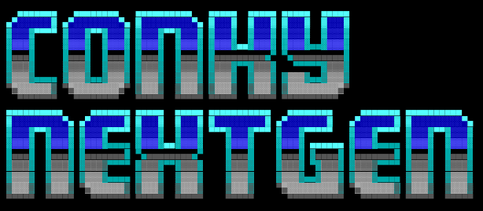
</p>

# Conky NextGen

Conky NextGen is a modular Conky framework with a Lua/Cairo renderer, Bash
data fetchers, self-contained themed widgets, and a GTK3 visual Designer. It
supports X11 and Wayland-capable Conky builds.

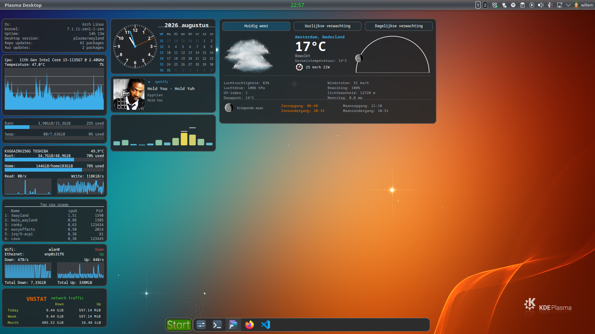

## Engine Requirement: conky-mng

> [!IMPORTANT]
> Conky NextGen requires the **`conky-mng`** engine (Conky 1.25+ compiled with mouse events, Lua 5.4, and flicker-free X11 window reload). Stock distribution builds (such as Ubuntu's `conky-all` 1.22.x) **do not support mouse events** and will fail.
> - **Ubuntu / Debian:** A pre-compiled stable `.deb` package is provided in the repository: [`pkg/conky-mng_1.25.2.r7.g6628aff-1_amd64.deb`](pkg/conky-mng_1.25.2.r7.g6628aff-1_amd64.deb).
> - **Arch Linux:** Available via [`pkg/PKGBUILD`](pkg/PKGBUILD) / AUR (`conky-mng-git`).

## Quick start

### Method 1: Git Clone (Recommended / Stable)

Cloning the repository directly is the most mature and battle-tested way to run Conky NextGen:

```bash
git clone https://github.com/molnari811023/conky-nextgen.git ~/.conky
cd ~/.conky

# Fetch weather, alerts, maps, media, network, and optional Google data.
bash sh/fetch_all.sh

# Start any widget directly (dynamic paths allow launching from any directory).
conky -c clock_cal.conf
# Or any custom/renamed configuration:
conky -c akarmi.conf

# Start the visual Designer.
python3 sh/designer/main.py
```

The default weather location is Vienna. Supply a city name to fetch weather
for another location:

```bash
bash sh/fetch_all.sh Budapest
```

### Method 2: Native Packages (`conky-nextgen` — Testing / WIP)

> [!WARNING]
> **Package status notice:**
> - The standalone `conky-nextgen` packages were **freshly created today** and are currently in **active testing / unstable (WIP)**. There may still be minor edge cases or packaging bugs.
> - **Debian / Ubuntu (.deb):** Initial live testing has been completed successfully on Ubuntu 26.04.
> - **Arch Linux (AUR / PKGBUILD):** The `PKGBUILD` and build scripts are provided in `pkg/aur/`, but **have NOT been tested on live Arch Linux yet**. Testers and community feedback are welcome!
> - **Rock-solid fallback:** If you encounter any packaging issues, cloning the repository directly (**Method 1**) and launching widgets via `conky -c <widget>.conf` (or `conky -c akarmi.conf`) is completely independent, mature, and guaranteed to work out of the box.

To install and test the Debian/Ubuntu package:
```bash
sudo apt install ./pkg/conky-nextgen_1.0.0.*_all.deb
```

Once installed, it provides:
- CLI widget manager: `conky-nextgen start [widget]`, `conky-nextgen stop`, `conky-nextgen list`, `conky-nextgen status`
- Shell auto-completion: native Bash completion with Tab support for commands and widget names
- Visual Designer application launcher: `nextgen-designer`
- UNIX manual pages: `man conky-nextgen` and `man nextgen-designer`

### Customizing Widgets & Fixing "Show Desktop" (Win + D)

System widgets installed under `/usr/share/conky-nextgen/` are read-only templates. To customize widget positions or window behavior:

1. **Copy the widget to your home directory:**
   ```bash
   # Copy all templates to ~/.conky:
   conky-nextgen init ~/.conky

   # Or copy an individual widget:
   cp /usr/share/conky-nextgen/clock_cal.conf ~/.conky/my_clock.conf
   ```

2. **Prevent disappearing on "Show Desktop" (`Win + D` / `Super + D`):**
   In desktop environments like MATE, XFCE, or GNOME, pressing `Win+D` may minimize Conky if `own_window_type` is not tailored to your compositor.
   
   Edit your `~/.conky/*.conf` file:
   ```lua
   conky.config = {
       -- Window behavior settings:
       own_window = true,
       own_window_transparent = true,
       own_window_argb_visual = true,
       own_window_class = 'Conky',

       -- Option A: 'normal' with below/sticky hints (best for mouse clicks in MATE / XFCE)
       own_window_type = 'normal',
       own_window_hints = 'undecorated,below,sticky,skip_taskbar,skip_pager',

       -- Option B: 'desktop' (pinned to root desktop, immune to Win+D in most DEs)
       -- own_window_type = 'desktop',

       -- Option C: 'dock' (treated as a system panel, stays below/above windows)
       -- own_window_type = 'dock',

       -- Screen coordinates:
       alignment = 'top_right',
       gap_x = 20,
       gap_y = 50,
   }
   ```

3. **Launch your customized widget:**
   ```bash
   conky -c ~/.conky/my_clock.conf
   # Or using the CLI:
   conky-nextgen start my_clock
   ```

The Designer writes widget files atomically and sends `SIGUSR1` to reload the
live preview without restarting the Conky process.

## Included widgets

Every root-level `.conf` file starts the matching `.lua` widget. The current
bundles are:

| Widget | Purpose |
|---|---|
| `clock_cal` | analog clock and calendar |
| `cpu`, `mem_swap`, `disk`, `nvidia` | system, memory, storage, and GPU information |
| `info`, `top`, `left` | system dashboards and multi-view layouts |
| `weather` | current, hourly, and daily weather views |
| `lyrics` | synchronized lyric display |
| `widget` | Designer-managed general-purpose widget |

## Screenshots

| Clock and calendar | Calendar view | System information |
|:---:|:---:|:---:|
| 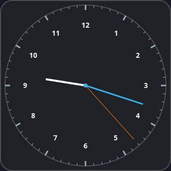 | 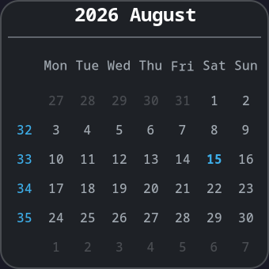 | 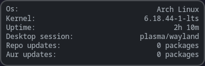 |

| CPU | CPU alternative view | Memory and swap |
|:---:|:---:|:---:|
| 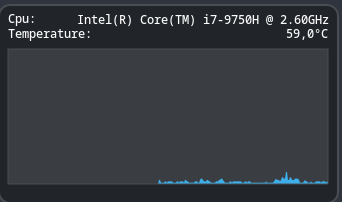 | 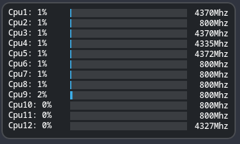 | 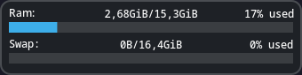 |

| Disk | NVIDIA GPU | Top processes | Top processes alternative view |
|:---:|:---:|:---:|:---:|
|  | 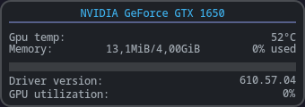 | 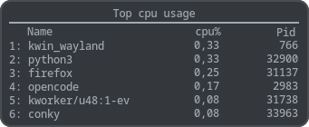 | 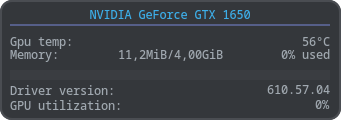 |

| Current weather | Hourly forecast | Daily forecast |
|:---:|:---:|:---:|
| 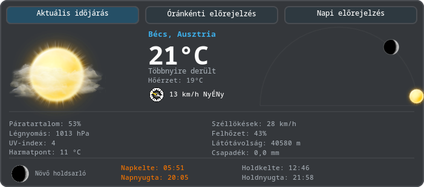 | 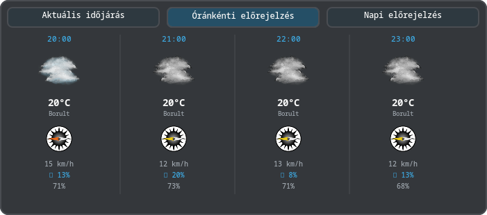 | 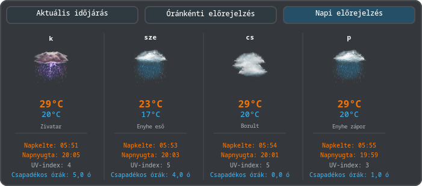 |

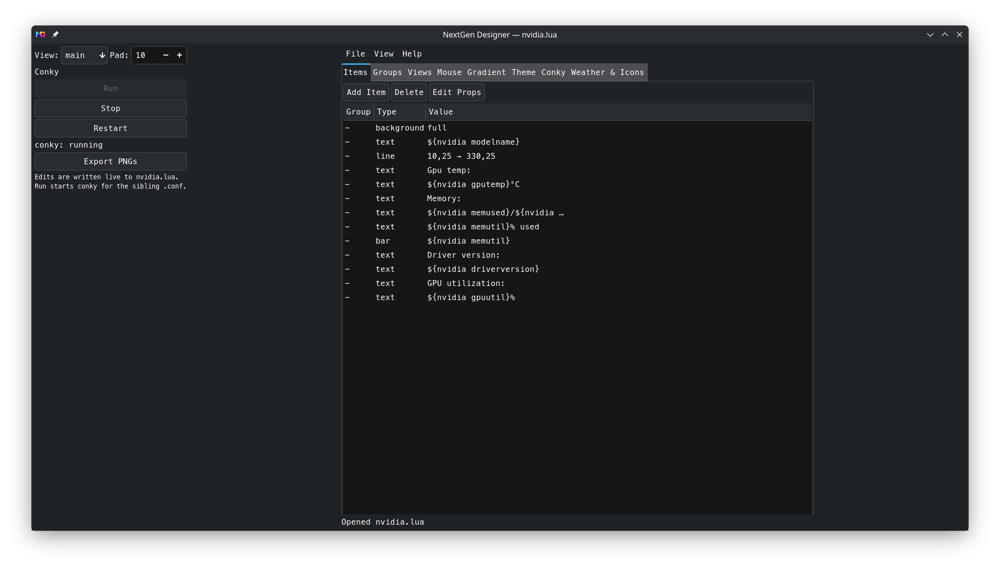

## Designer

Run the GTK3 Designer with:

```bash
python3 sh/designer/main.py
```

It edits `widget.lua` and `widget.conf`, provides a live Conky preview, and
includes widget, theme, view, group, mouse, weather, and Conky configuration
controls. Module profiles are fixed checkboxes in the left-side **Profile**
panel, so selecting them does not cover any other control.

Profiles choose data modules while every visual renderer remains available:

| Profile | Loads data for |
|---|---|
| `basic` | no additional data source |
| `weather` | weather, alerts, air quality, sun, moon, city, and icons |
| `system` | hardware, battery, DMI, MTP, network, sensors, and USB |
| `media` | now-playing and song-text data |
| `panel` | panel system data |
| `google` | Google cache data |
| `full` | weather, system, media, and Google data |

Profiles can be combined, for example:

```lua
MODULE_PROFILE = { "weather", "media" }
```

`full` is exclusive. Invalid profile definitions, missing required modules,
and invalid Lua renderer expressions fail explicitly instead of being silently
ignored.

## Fetching data

All fetchers are Bash scripts. Run them with `bash`, not a generic `sh`
wrapper. They update the generated `tmp/` cache, which is intentionally not
stored in Git.

| Command | Purpose |
|---|---|
| `bash sh/fetch_all.sh` | fetch all regular data |
| `bash sh/fetch_all.sh weather` | fetch weather only |
| `bash sh/fetch_all.sh alerts` | fetch MeteoAlarm alerts |
| `bash sh/fetch_all.sh map` | fetch weather maps |
| `bash sh/fetch_all.sh nowplaying` | fetch media-player data |
| `bash sh/fetch_all.sh network` | fetch ping and public-IP data |
| `bash sh/fetch_all.sh google` | fetch optional Google data through `gog` |
| `bash sh/fetch_updates.sh` | fetch the optional Arch update counter |

For periodic refreshes, use Bash explicitly in cron:

```cron
0 * * * * /bin/bash /path/to/conky-nextgen/sh/fetch_all.sh && /bin/bash /path/to/conky-nextgen/sh/fetch_updates.sh
```

## Requirements

Package names vary between distributions. The project needs:

- Conky built with Lua, Cairo, Xft, Imlib2, and RSVG support;
- Python 3 with PyGObject/GTK3 for the Designer;
- Bash, `curl`, `jq`, and `python3` for the fetcher framework;
- Lua bindings including `cairo`, `rsvg`, `imlib2`, `lfs`, and `dkjson`;
- `ImageMagick` for map images and `ping` for network latency;
- optional tools according to enabled modules: `playerctl`, `cmus-remote`,
  `mpc`, `mocp`, `gog`, `lm-sensors`, `upower`, and Arch package tools.

## Project layout

```text
.
├── *.lua / *.conf   standalone widget bundles
├── debug/           renderer stress tests and diagnostics
├── icons/           weather, moon, wind, and UI assets
├── language/        gettext catalogs and translation template
├── lua/             core engine, renderers, and data modules
├── panel_systray/   panel and systray helper sources/configuration
├── pkg/             package build files and patches
├── sh/              fetchers and the GTK3 Designer
├── tools/           development utilities
└── tmp/             generated runtime cache
```

## Documentation and validation

The detailed, source-derived reference is in
[NextGen.md](NextGen.md). It documents the renderer properties, Lua modules,
fetchers, Designer components, profiles, translations, panel integration, and
debug tooling.

Run the Designer schema and round-trip regression test with:

```bash
cd sh/designer
python3 tests/test_widget_schema.py
```
